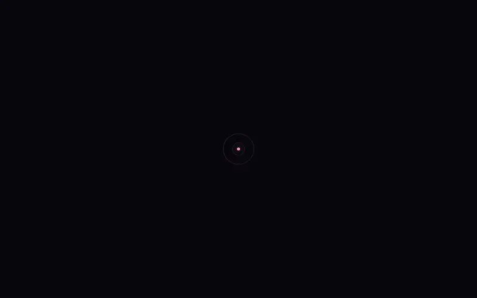
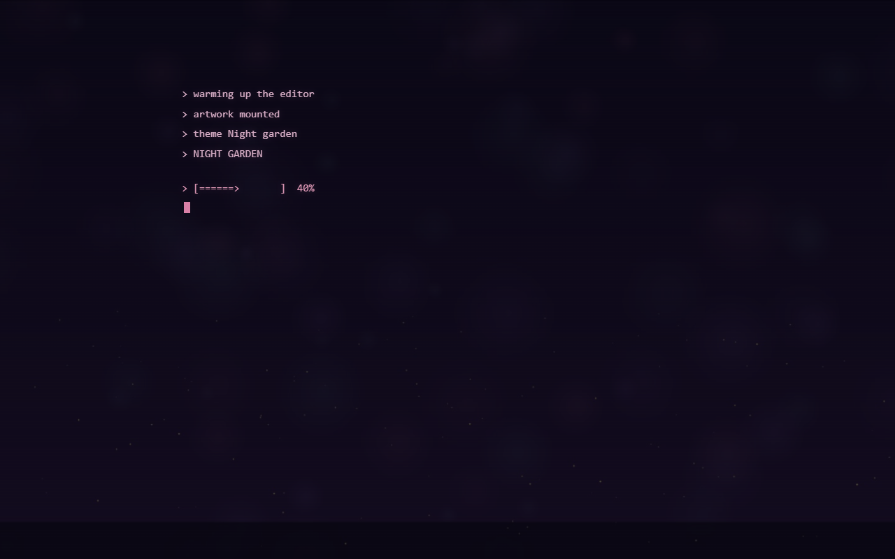
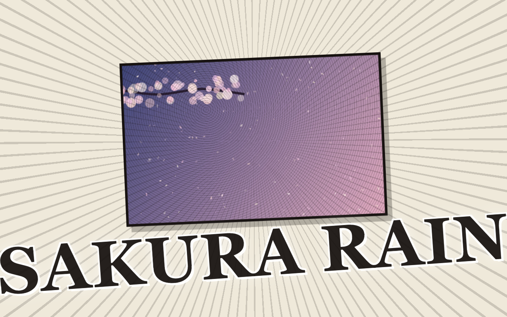
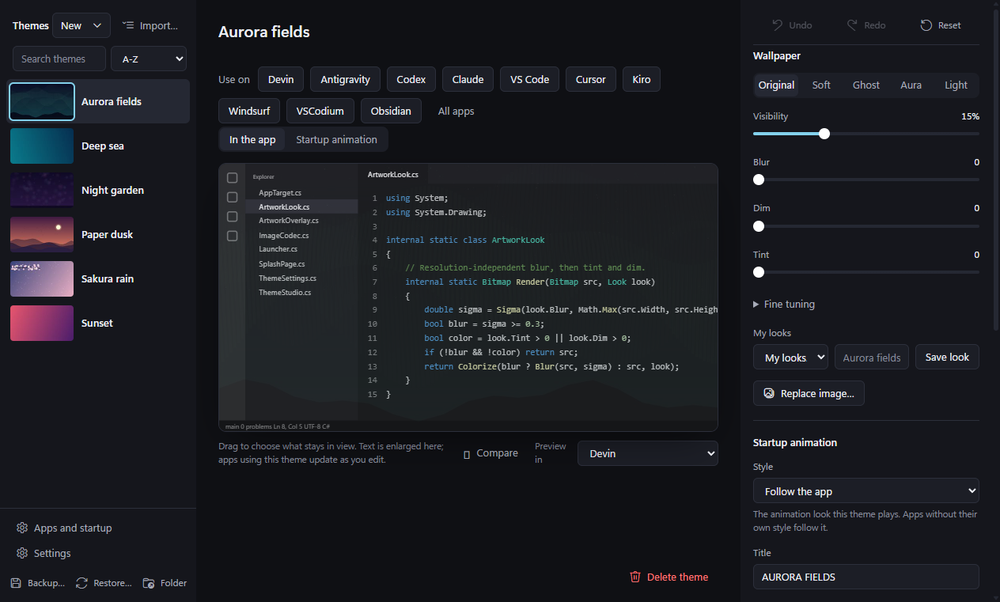
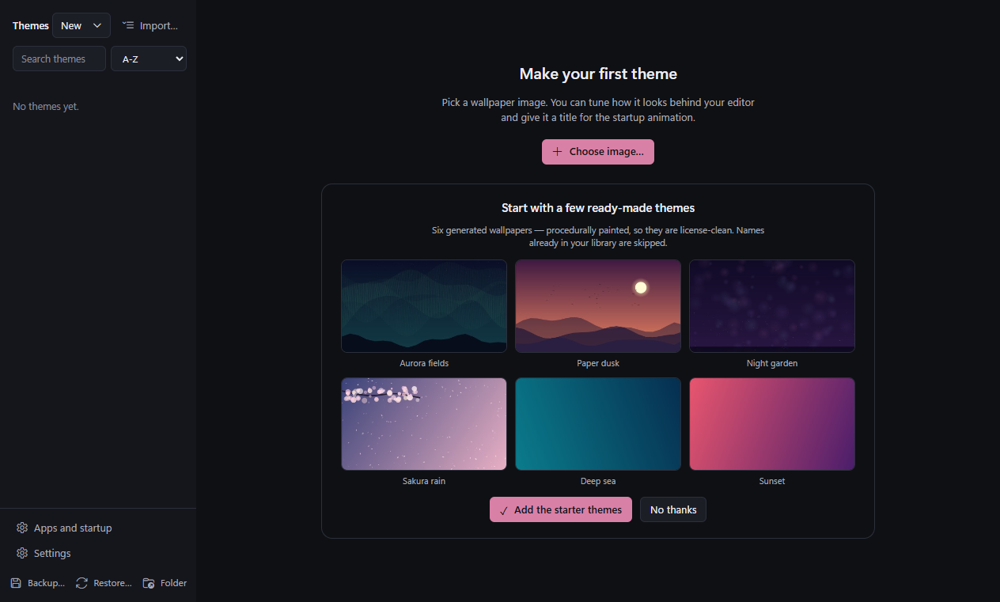

# Animated Launchers

**A startup animation and a soft, readable wallpaper inside your AI tools and code editors — on Windows.**

Open Devin, Codex, Claude, VS Code or any of the other supported apps the way you always do: a short
animation plays while the app loads, and your wallpaper stays behind your work inside the app window.
Themes, looks and the animation are edited in **Theme Studio**, and one theme library serves every app.



[**Download the latest release**](https://github.com/Synaap/Codex-Animated/releases/latest) ·
[How it works](docs/how-it-works.md) · [Roadmap](ROADMAP.md) · [Changelog](CHANGELOG.md)

## Highlights

- **Works however you open an app** — taskbar, Start menu, a file or a launcher. Never when the app
  was already open, never over a full-screen game or a presentation, one animation at a time.
- **Five animation styles** — the original Full sequence, a three-second Card, Terminal, Manga and
  Minimal — with your own title, fonts, avatar frame and boot lines.
- **Wallpaper inside the app**, on every window it opens. Clicks and typing go straight to the app.
- **Looks that keep text readable** — visibility, blur, dim, tint, a clear zone on one side, glow,
  vignette, a light-app mode and fit modes down to crisp pixel art.
- **Theme Studio** — live preview, undo, drag-and-drop import, shareable `.altheme` files, six starter
  themes painted in code, and a French or English interface.
- **Variety** — rotate themes, follow Windows light and dark mode, give an app a night theme.
- **Private by design** — it never changes the apps, runs no code inside them and collects nothing.
  The only network access is the update check you click.

## Supported apps

| App | Launcher | Status |
| --- | --- | --- |
| Devin | `DevinAnimated.exe` | Tested |
| Antigravity IDE | `AntigravityAnimated.exe` | Tested |
| Codex | `CodexAnimated.exe` | Tested |
| Claude | `ClaudeAnimated.exe` | Tested |
| VS Code | `VSCodeAnimated.exe` | Tested |
| Cursor | `CursorAnimated.exe` | Tested |
| Kiro | `KiroAnimated.exe` | Tested |
| Obsidian | `ObsidianAnimated.exe` | Tested |
| Windsurf | `WindsurfAnimated.exe` | Detected, not tested yet |
| VSCodium | `VSCodiumAnimated.exe` | Detected, not tested yet |
| **Any other program** | — | Add it in Theme Studio |

Any other desktop program can join: **Apps and startup → Add your own app** takes the program's
`.exe` and gives it the same wallpaper, animation and settings, frameless windows included. The
helper picks it up at once, and **Remove** takes it back out.

## Install

You need 64-bit Windows, at least one supported app, and the
[Microsoft Edge WebView2 Runtime](https://developer.microsoft.com/microsoft-edge/webview2/#download)
(already present on most PCs; the animation and Theme Studio use it).

1. Download `Codex-Animated-v…-windows-x64.zip` from
   [Releases](https://github.com/Synaap/Codex-Animated/releases).
2. Double-click **`Setup.exe`** inside it — or extract the zip and double-click **`Install.cmd`**.
   Both run the same per-user install; no administrator rights are needed.

The installer puts everything in `%LOCALAPPDATA%\Programs\AnimatedLaunchers`, creates one launcher
per installed app, gives each launcher shortcut its app's own icon, adds **Theme Studio** to the
Start menu, and starts the shared helper (it also starts with Windows). Installing over an older
version keeps your themes and settings. The project appears under **Settings → Apps → Installed
apps** as **Animated Launchers**.

From a clone of this repository, `Install.cmd` builds the programs first and then does the same.

## Using it

### The startup animation

It plays when an app starts and its window comes to the front. A launcher (`DevinAnimated.exe`
and so on) opens the app at once and plays the animation on top while the app loads. Click
anywhere, choose **Skip** or press **Esc** to close it. When Windows asks for reduced motion, a calm
title card plays instead. To watch an animation by itself, run a launcher with `--preview`.

Each theme picks its style: **Full** (12 seconds), **Card**, **Terminal**, **Manga** or **Minimal**.
Boot lines can use `{app}`, `{theme}`, `{user}`, `{date}`, `{time}` and `{starts}`, and a line pool
adds one random line each time.

| | |
| --- | --- |
|  |  |

### The wallpaper inside the app

The helper draws your wallpaper inside the app window at the visibility you chose, on every window
the app opens. It follows the window when you drag, resize or maximize it, and it steps aside on
its own while an app window is in real full screen or Windows is in presentation mode.

Right-click the **Animated Launchers** icon in the notification area (it may be under the hidden
icons) for a menu per app: **Theme**, **Next theme**, **Hide/Show artwork**, **More/Less visible**,
the startup animation on or off, and **Stop watching**. **Win+Alt+H** hides or shows the artwork in
every app at once. **Theme Studio…** opens the editor; **Exit** closes the helper and leaves the
apps as they are.

### Theme Studio



- **The list** on the left holds your themes, with search, sorting and favorites. **New** makes a
  theme from an image, a folder of images, the desktop wallpaper, the clipboard or a gradient.
- **The preview** shows the wallpaper behind a mock of the app (drag it to choose what stays in
  view; hold **C** to compare with the untouched picture) or plays the real animation page.
- **The inspector** on the right holds the look (presets plus fine tuning), the animation text,
  font, avatar and style, and the credit line. Edits save by themselves and reach running apps at
  once; **Ctrl+Z** undoes them. **Use on** puts the theme on one app or on all of them.
- **Sharing**: **Export** writes one `.altheme` file you can send to anyone; **Import**, dropping a
  file on the window or double-clicking it brings it back. **Backup** and **Restore** cover the
  whole library. Importing never overwrites an existing theme.
- **Apps and startup** sets, per app: its theme, the animation (on/off, speed, style, first start
  only), theme rotation, a light-mode and a night theme with their hours, extra dimming, hiding in
  full screen, and a live status line (attached, watching, off or parked).
- **Settings**: the language (Same as Windows, English, Français), **Check for updates** with
  one-click install, **Copy report** for bug reports, the logs folder and **Restart helpers**.



A new library starts with an offer of six starter themes — Aurora fields, Paper dusk, Night garden,
Sakura rain, Deep sea and Sunset — all painted in code, so there is nothing to license.

## Privacy and safety

- It never modifies the apps or their settings, and never runs code inside them: the wallpaper is
  the helper's own click-through window placed inside the app's window.
- No telemetry, no accounts. Logs stay on the PC and never contain window titles or file contents.
- The only network requests are **Check for updates** (GitHub's release API) and, when you click
  it, **Download and install**, which is checked against the release's published SHA-256.

[How it works](docs/how-it-works.md) explains each part in more detail.

## When something goes wrong

- In Theme Studio, **Settings → Copy report** puts each app's status and the end of the helper logs
  on the clipboard — paste it into a [bug report](https://github.com/Synaap/Codex-Animated/issues/new/choose).
- The helper log is `%LOCALAPPDATA%\Animated Launchers\Logs\helper.log` (at most 256 KB, plus the
  previous file).
- If the helper crashes, it restarts itself once. An error inside one app's part parks only that
  app — the others keep their artwork, and the app's tray menu offers **Try again**.
- **Settings → Restart helpers** picks up new settings and clears a stuck session.

## Where your data lives

| Path under `%LOCALAPPDATA%` | What it holds |
| --- | --- |
| `Animated Launchers\Themes\<name>\` | Each theme: `theme.ini`, `wallpaper.jpg` and an optional `avatar.jpg` |
| `<App> Animated\` | One app's `settings.ini`, its own copy of the wallpaper and avatar, and `status.ini` |
| `Animated Launchers\studio.ini` | Theme Studio's window position, sorting, favorites and language |
| `Animated Launchers\custom-apps.ini` | The apps you added yourself |
| `Animated Launchers\Looks\` | Your saved look presets |
| `Animated Launchers\Logs\` | The helper log |

## Build from source

On x64 Windows, from the repository root:

```powershell
.\source\Build.ps1      # builds AnimatedLauncher.exe and ThemeStudio.exe
.\tools\Test.ps1        # offline tests for looks, themes, settings, logs and packaging
.\tools\Package.ps1     # writes the release zip (with Setup.exe) and its .sha256 to dist\
```

The build uses the .NET Framework C# compiler that ships with Windows and the WebView2 SDK DLLs in
the repository — nothing to install. The supported apps are described once, in
`source/AppTable.cs`; a copy of the program named `<App>Animated.exe` is that app's launcher, and
`AnimatedLauncher.exe --artwork` is the shared helper. The animation lives in `web/` and Theme
Studio's page in `studio/`. `.github/workflows/build.yml` builds, tests and packages the project
on GitHub Actions.

## Uninstall

Open **Settings → Apps → Installed apps**, find **Animated Launchers** and choose **Uninstall**, or
run `Uninstall.cmd` from the install folder. It stops the helper, removes the start-with-Windows
entry, points your shortcuts back to the apps and removes the program folder. It asks whether to
delete your themes and settings too; `Uninstall.ps1 -WhatIf` shows what it would do.

## Credits

Animated Launchers began as Synaap's Codex Animated. The portrait startup animation is adapted from
panding999's [Codex Startup Animation](https://github.com/panding999/codex-startup-animation/tree/c743c2b5eceaa7be9dc511d23a1a77f7c4ce6248),
and the default wallpaper is the sunset illustration supplied for the 1.2.1 release.

The programs use Microsoft.Web.WebView2 `1.0.4314.35`; its [license](notices/LICENSE.txt) and
[third-party notices](notices/NOTICE.txt) ship with every release.
